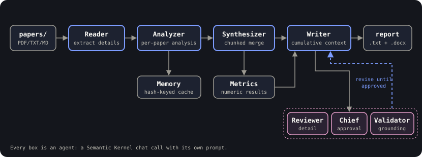

<p align="center">
  
</p>

<h1 align="center">Multi-Agent Research Paper Synthesis with a Local LLM</h1>

<h2 align="center"><em>Read. Analyze. Synthesize. Verify.</em></h2>

<p align="center">
  Drop a folder of research papers in, get a dense, multi-section synthesis report out (plain text + Word).
  A pipeline of specialized agents reads, analyzes and compares every paper, and a reviewer–validator loop
  checks the draft against the sources before it is saved. Runs entirely on a <strong>local LLM</strong> via LM Studio:
  no cloud API key, no per-token cost.
</p>

<div align="center">

[](https://github.com/Berkaybbayramoglu/PaperSynth)
[](https://www.python.org/)
[](https://learn.microsoft.com/en-us/semantic-kernel/)
[-2ea44f?style=flat-square)](https://lmstudio.ai/)
[](#what-it-produces)

</div>

<p align="center">
  <a href="https://github.com/Berkaybbayramoglu/PaperSynth"></a>
  &nbsp;
  <a href="#quick-start"></a>
  &nbsp;
  <a href="https://github.com/Berkaybbayramoglu/PaperSynth/issues"></a>
</p>

---

## Quick Start

```bash
pip install -r requirements.txt
# start a local OpenAI-compatible server (e.g. LM Studio on http://localhost:1234/v1), then:
python main.py path/to/papers/
# -> research_report_20260517_154301.txt
# -> research_report_20260517_154301.docx   (15-25 pages of formatted output)
```

---

## Why PaperSynth?

- **As a tool** — process literature reviews, conference proceedings, patent batches, or any directory of PDFs you would otherwise read by hand. The output is structured (overview → per-paper analysis → thematic comparison → conclusions) and faithful to the source: a dedicated validator agent catches hallucinations before the report is saved.
- **As a reference codebase** — a real multi-agent system in ~2,400 lines, organized so you can read it top to bottom. If you have ever wondered how to chunk a long input across LLM calls, cache expensive agent outputs, or build a "judge-then-fix" loop, this repo is a working example. See [Reading the code](#reading-the-code).

---

## What it produces

The report has four sections; here's a real (trimmed) excerpt:

```
OVERVIEW
This synthesis covers six papers on AI applications in livestock
management, spanning empirical studies (Zhang 2025, Biswas 2023) and
conceptual frameworks (Hamadani 2024)...

PAPER 1: Zhang2025Big.pdf
================================================================================
PAPER DETAILS
Zhang et al. (2025), "Big-data-driven precision livestock farming",
published in Computers and Electronics in Agriculture, empirical study.

APPROACH
The authors deployed a Random Forest classifier (100 trees,
max_depth=10) on a dataset of 10,432 dairy-cattle records collected
across 50 farms over 18 months...

INTEGRATED SYNTHESIS AND COMPARISON

A. APPROACHES
Three papers used CNNs (Biswas: ResNet-50 92%, Li: custom 95.3%,
Patel: EfficientNet 91.7%). Two papers proposed conceptual frameworks
without empirical validation...
```

You also get `analysis_cache.json` (per-paper results, so reruns are
fast) and `synthesis_progress.json` (a per-stage event log for
debugging).

---

## Architecture

<p align="center">
  
</p>

Each stage is an agent — a Semantic Kernel chat call with its own prompt. The Writer / Reviewer / Validator loop iterates until both reviewers approve and the validator finds no fabricated content (or `max_iterations` is reached).

| Agent | Role |
|---|---|
| `ReaderAgent` | Extracts text from PDFs and asks the LLM to pull out every detail. |
| `AnalyzerAgent` | Writes a detailed analysis for each paper (cached via `MemoryAgent`). |
| `MemoryAgent` | Disk-backed cache of per-paper analyses, keyed by content hash. |
| `SynthesizerAgent` | Merges all analyses; chunks input if it exceeds the context window. |
| `MetricsExtractorAgent` | Pulls out every numeric result (accuracy, F1, dataset size, etc.). |
| `WriterAgent` | Drafts the final report with cumulative context across chunks. |
| `ReviewerAgent` | First-pass reviewer; rejects vague or under-detailed sections. |
| `ChiefReviewerAgent` | Final approval; rejects reports that are too brief or repetitive. |
| `ValidationAgent` | Cross-checks the report against the synthesis to catch hallucinations. |
| `OrderVerificationAgent` | Ensures papers stay in their original order through the pipeline. |
| `ProgressTracker` | Writes a JSON log of every stage and event. |

---

## Installation

```bash
pip install -r requirements.txt
```

Then start a local LLM server:

1. Install [LM Studio](https://lmstudio.ai/), load a chat model (default
   is `qwen3-vl-8b` — any 8B+ instruction-tuned model works).
2. Start the local server on `http://localhost:1234/v1`.
3. To use a different endpoint or model, edit `LLM_BASE_URL` /
   `LLM_MODEL_ID` at the top of `main.py`. Any OpenAI-compatible
   endpoint works (vLLM, TGI, Ollama with the OpenAI compatibility
   layer, or the OpenAI / Anthropic APIs themselves).

---

## Usage

```bash
# Process every supported file in the given directory
python main.py path/to/my_papers/

# Or create a ./papers/ folder and run with no arguments
python main.py
```

You can mix PDF, TXT, and Markdown files in the same directory.

---

## Configuration

The most useful knobs live in `main.py` and on
`ResearchSynthesisBehaviorTree.run`:

| Parameter | Default | What it does |
|---|---|---|
| `LLM_BASE_URL` | `http://localhost:1234/v1` | OpenAI-compatible endpoint |
| `LLM_MODEL_ID` | `qwen3-vl-8b` | Model name the endpoint should serve |
| `max_iterations` | `3` | Max Writer ↔ Reviewer rounds before giving up |
| `parallel_processing` | `False` | Enable concurrent LLM calls — only useful if your backend handles parallel requests |
| `read_batch_size` | `6` | Papers read per parallel batch |
| `analyze_batch_size` | `4` | Papers analyzed per parallel batch |

LM Studio and llama.cpp's server queue requests internally, so leave
parallel mode off for those. Turn it on for vLLM, TGI, or hosted APIs.

---

## Project layout

```
research-synthesis-system/
├── main.py                       # Entry point: wires agents, runs the pipeline
├── requirements.txt
└── research_synthesis/
    ├── agents/                   # One file per agent
    │   ├── reader.py
    │   ├── analyzer.py
    │   ├── synthesizer.py
    │   ├── writer.py
    │   ├── reviewer.py
    │   ├── chief_reviewer.py
    │   ├── validator.py
    │   ├── metrics_extractor.py
    │   ├── order_verifier.py
    │   └── memory.py
    ├── core/
    │   ├── behavior_tree.py      # Top-level orchestrator
    │   └── progress_tracker.py   # JSON-backed event log
    ├── output/
    │   └── word_export.py        # Renders the .docx report
    └── utils/
        └── text_cleaning.py      # Strips markdown from LLM output
```

---

## Reading the code

If you're using this repo to learn how multi-agent LLM systems are
built, here's the recommended reading order. Each file only depends on
ones above it.

| # | File | Concept to learn |
|---|---|---|
| 1 | `main.py` | Wiring agents together and configuring the LLM client |
| 2 | `core/behavior_tree.py` | Top-level orchestration: Read → Analyze → Synthesize → Write → Review |
| 3 | `agents/reader.py` | The simplest agent shape: I/O + one LLM call per chunk |
| 4 | `agents/memory.py` | Disk caching with content hashes and atomic JSON writes |
| 5 | `agents/synthesizer.py` | Chunked processing when input exceeds the context window |
| 6 | `agents/writer.py` | Cumulative context, incremental fixes, dynamic token budgeting |
| 7 | `agents/reviewer.py`, `chief_reviewer.py`, `validator.py` | The "judge" pattern — agents that approve/reject other agents' output |
| 8 | `output/word_export.py` | Pure Python — turning plain text into a styled `.docx` |

Most of the codebase is **prompt text**, not control flow. That's the
real lesson: in LLM systems, the design work is in the prompts.

### Notable design decisions

- **Why a pipeline instead of one big prompt?** A single "summarize all
  these papers" prompt blows the context window and produces shallow
  output. Splitting the work into specialized stages lets each call
  focus on one job and fit comfortably in context.
- **Why three separate judge agents?** Asking one LLM call to evaluate
  rigor + repetition + hallucination at once produces vague feedback.
  Three specific prompts produce three specific feedback lists that the
  Writer can actually act on.
- **Why chunked Writer with cumulative context?** A 6-paper synthesis
  easily reaches 30k chars. Splitting along `PAPER N:` boundaries and
  passing the already-written portion into each subsequent chunk keeps
  the style and detail level uniform across the full report.
- **Why the disk cache?** Reruns after a downstream prompt tweak skip
  the expensive Analyzer step. The content hash invalidates
  automatically when a paper changes.
- **Why `parallel_processing=False` by default?** Single-GPU local LLMs
  queue requests anyway; concurrency just makes failures harder to
  debug.

---

## Troubleshooting

| Symptom | Likely cause | Fix |
|---|---|---|
| `Connection refused` on startup | Local LLM server isn't running | Start LM Studio; verify with `curl http://localhost:1234/v1/models` |
| "No papers read successfully" | PDFs are scanned images, not text | Pre-OCR them or use TXT/MD versions |
| Report keeps getting REJECTED | Local model too small to follow the strict format rules | Try a 13B+ instruction-tuned model, or set `max_iterations=1` |
| `KeyError` in progress JSON | Old `synthesis_progress.json` from a previous version | Delete it; a new one is created per run |
| Output still has `**bold**` or `\|tables\|` | An edge case `clean_markdown` missed | Add a regex to `utils/text_cleaning.py` |

---

## Further reading

- [Semantic Kernel docs](https://learn.microsoft.com/en-us/semantic-kernel/) — the underlying SDK
- [Anthropic, "Building effective agents"](https://www.anthropic.com/research/building-effective-agents) — taxonomy of agent patterns
- [LangChain text splitters](https://python.langchain.com/docs/concepts/text_splitters/) — alternative chunking strategies

---

## Contributors

[Berkay Bayramoğlu](https://github.com/Berkaybbayramoglu)

---

## Contributing

Contributions are welcome, especially new agents, better chunking strategies and support for more input formats.

- Open an issue to discuss larger changes before implementing them
- Keep each agent in its own file under `research_synthesis/agents/`
- Describe how a change affects report quality or runtime

---

<p align="center">
  <strong>PaperSynth</strong><br/>
  <sub>Reader → Analyzer → Synthesizer → Writer → Reviewer / Validator</sub><br/>
  <sub>Local-first. Multi-agent. Source-faithful.</sub>
</p>

<p align="center">
  <a href="https://github.com/Berkaybbayramoglu/PaperSynth">Repository</a> ·
  <a href="https://github.com/Berkaybbayramoglu/PaperSynth/issues">Issue Tracker</a>
</p>
